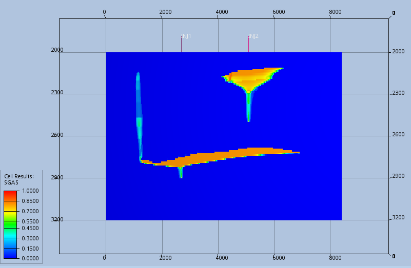
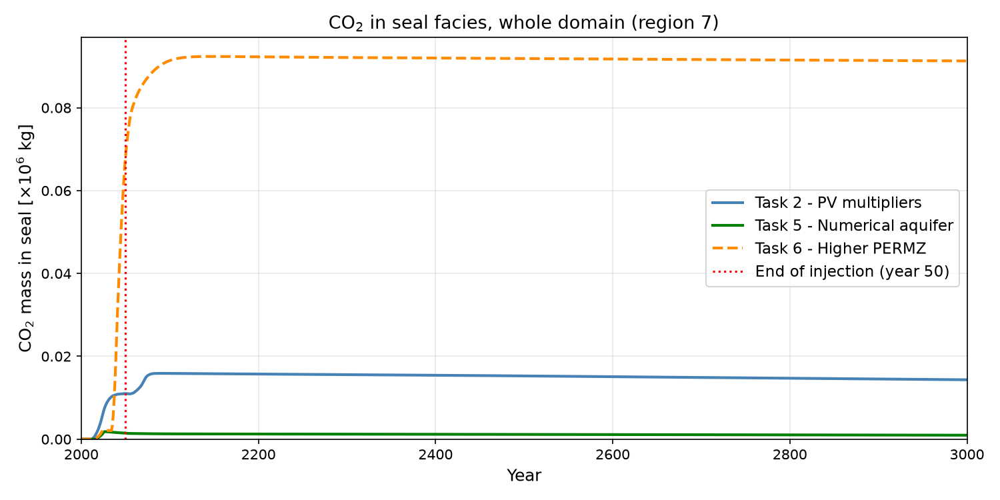

# Geological CO₂ Storage: SPE11B Benchmark with OPM Flow

Reservoir simulation of CO₂ injection into a saline aquifer, based on the **11th SPE Comparative Solution Project (SPE11B)**. It covers a 2D field-scale cross-section (8.4 km × 1.2 km, 101,040 cells, seven geological facies), two injection wells, 50 years of injection and 950 years of post-injection monitoring.

I built the simulation decks from the benchmark specification and ran them with **OPM Flow 2025.10** (`CO2STORE` + `DISGASW`). I then post-processed the summary output in Python to compare how the **boundary conditions** and the **vertical permeability** control CO₂ migration, trapping and seal integrity.

📄 **Full report:** [`report/SPE11B_CO2_storage_report.pdf`](report/SPE11B_CO2_storage_report.pdf)

<p align="center">
  
  
</p>

*Left: free-phase CO₂ (SGAS) at the end of injection. CO₂ from INJ1 rises, spreads under the seal and migrates up the fault towards Box B. Right: CO₂ mass that enters the seal facies. Lower anisotropy (Task 6) gives about 6× more seal breach than the base case.*

---

## Key results

| Variant | Boundary condition | k<sub>v</sub>/k<sub>h</sub> | Main finding |
|---|---|---|---|
| **Task 2 – Base** | Pore-volume multipliers (`PVBOUNDARIES.INC`) | 0.1 | CO₂ accumulates under the primary seal (Box A). Part of it migrates through the fault into Box B |
| **Task 5 – Aquifer** | Numerical aquifers (`AQUNUM`/`AQUCON`) on the left and right edges of Facies 5, with physical diffusion (`DIFFUSE`) | 0.1 | Higher interior pressure. Water influx blocks the fault pathway, so almost no CO₂ reaches Box B or the seal |
| **Task 6 – PERMZ** | Pore-volume multipliers | **0.5** | Faster vertical migration and dissolution, and much more CO₂ entering the seal facies |

* Mass balance check: FGIP ≈ FGIT for the whole run, so no CO₂ leaves the domain.
* Pressure at the observation points POP1 and POP2, and mobile CO₂ in Box A and Box B, fall within the spread of results reported by the SPE11 participants (Nordbotten et al., 2025).
* The choice of boundary condition changes both the pressure response and where the CO₂ ends up. Vertical permeability is a first-order control on seal integrity.

## Methods

* **Grid:** 842 × 1 × 120 cells (`DX.INC`), DZ = 10 m, top at 2000 m depth.
* **Rock properties:** PERMX and PORO per facies, PERMZ = 0.1·PERMX (10:1 anisotropy, Eq. 3.10 in the SPE11 description).
* **Saturation functions:** I built my own Brooks–Corey tables for each of the seven facies ([`saturation-functions/brooks_corey_tables.xlsx`](saturation-functions/brooks_corey_tables.xlsx)). They use k<sub>r,α</sub> = s<sub>α,n</sub><sup>1.5</sup>, a Leverett-J-scaled entry pressure and a capillary pressure capped at 300 bar. They are exported as `SGWFN.INC`.
* **Initialisation:** `EQUIL` at 2900 m and 300 bar, uniform temperature 70 °C (`RTEMP`).
* **Schedule:** INJ1 injects 1600 Sm³/day from year 0. INJ2 joins at year 25. Both shut in at year 50, and the simulation runs to year 1000.
* **Reporting:** Region-wise CO₂ inventories (`RGMMO`, `RGMUS`, `RGMDS`, `RGMST`) over 11 FIPNUM regions (Box A = 2+4+5, Box B = 3+6, seal = 5/6/7), plus well and pressure-observation vectors.

## Repository structure

```
decks/
  TASK2_BASE.DATA          base case (PV multipliers)
  TASK5_AQUIFER.DATA       numerical aquifers + DIFFUSE
  TASK6_PERMZ.DATA         sensitivity: PERMZ = 0.5 * PERMX
  include/                 grid, rock, region and saturation-function include files
  experiments/             development runs (see below)
saturation-functions/      Brooks-Corey table generation (spreadsheet)
results/summary/           summary vectors exported from OPM Flow / ResInsight (CSV)
analysis/plot_summary.py   regenerates every figure in figures/summary/
figures/resinsight/        SGAS, RSW and pressure maps from ResInsight
figures/summary/           time series comparing the three variants
report/                    final project report (PDF)
```

### Experiments (`decks/experiments/`)

These decks document how the final setup was reached. They are not part of the final comparison.

| Deck | What it tests |
|---|---|
| `EXP1_AQUIFER_FIRST_ATTEMPT.DATA` | First numerical-aquifer setup (2 km aquifers over K = 40–120) with the Facies 5 saturation tables for all facies (`SGWFN_5.INC`) |
| `EXP2_AQUIFER_FACIES5_SATFUNC.DATA` | Refined aquifer geometry (50 km, Facies 5 interval only) with uniform Facies 5 saturation functions |
| `EXP3_PULSED_INJECTION.DATA` | Pulsed injection (5 years on / 5 years off), with the boundary columns deactivated via `ACTNUM` |

## Reproducing

```bash
# 1) Run a simulation (OPM Flow, https://opm-project.org)
cd decks
mpirun -np 8 flow --enable-opm-rst-file=true TASK2_BASE.DATA

# 2) Regenerate the summary figures from the exported CSVs
pip install -r requirements.txt
python analysis/plot_summary.py
```

Simulation output (`.UNRST`, `.EGRID`, `.SMSPEC` …) is several GB and is not tracked. It is fully reproducible from the decks.

## Known limitations

* `DIFFUSE` conflicted with `PVBOUNDARIES.INC`, so it is only active in Task 5. The convective fingers in Task 2 and Task 6 are therefore driven by numerical diffusion and depend on the grid.
* The thermal effects and dispersion that are part of the full SPE11B specification are not modelled.
* RGMMO and RGMUS come out numerically identical. This is likely because the saturations stay close to the residual threshold.

## References

1. Nordbotten, J.M. et al. (2024). *The 11th Society of Petroleum Engineers Comparative Solution Project: Problem Definition.* SPE Journal. [doi:10.2118/218015-PA](https://doi.org/10.2118/218015-PA)
2. Nordbotten, J.M. et al. (2025). *Benchmarking CO₂ storage simulations: Results from the 11th SPE CSP.* IJGGC 148, 104519. [doi:10.1016/j.ijggc.2025.104519](https://doi.org/10.1016/j.ijggc.2025.104519)
3. SPE CSP 11 website: <https://www.spe.org/en/csp/spe11/>
4. OPM Flow Reference Manual (2025-10): <https://opm-project.org>

The grid, permeability, porosity and region include files were provided as course resources. They were generated with [pyopmspe11](https://github.com/OPM/pyopmspe11) (© NORCE, see the file headers).

---
*Project in ENERGI365, University of Bergen (spring 2026).*
